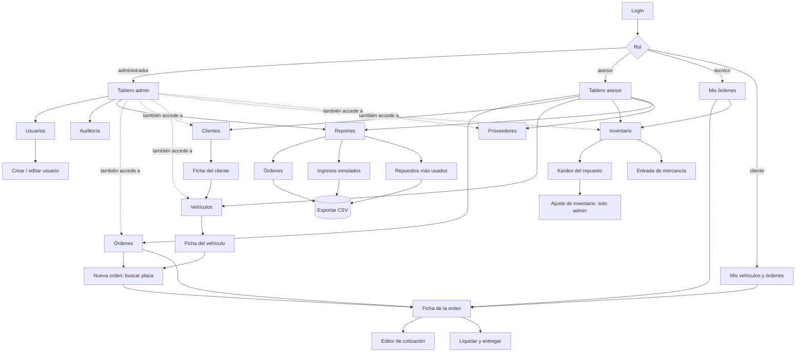
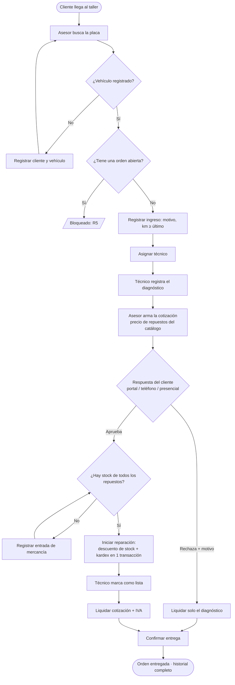
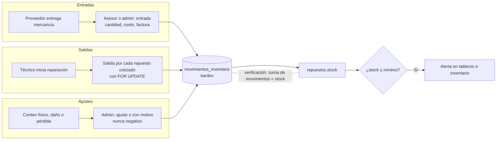
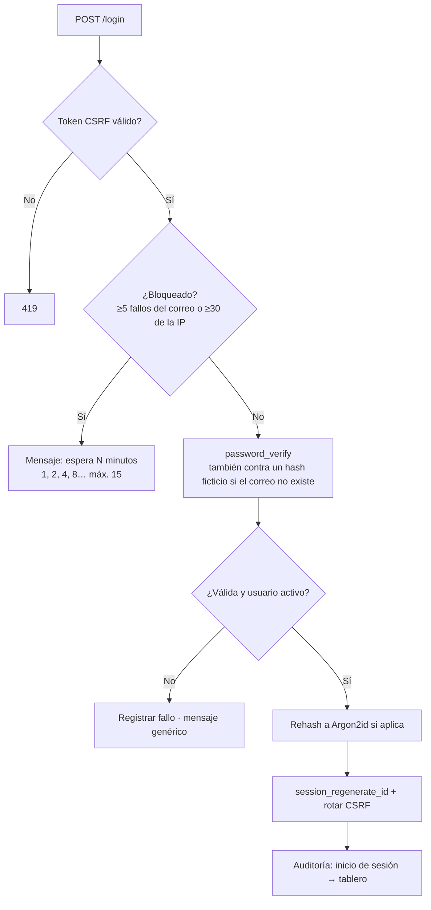

# Análisis y diseño técnico · Torque

> Entregables 3 (Análisis) y 4 (Diseño técnico) del proyecto final. Caso 08: Taller automotriz.
> Complementa a `docs/PROYECTO.md` (registro del proyecto), que contiene la matriz de permisos y el modelo de datos detallado.

## 1. Empresa (ficticia)

**Torque Servicio Automotriz** es un taller mecánico de una sede en Bogotá. Atiende vehículos particulares, motos y pequeñas flotas empresariales. Tiene 1 jefe de taller, 1 a 2 asesores de servicio en recepción, 2 técnicos y, en promedio, 10 a 15 vehículos por semana.

## 2. Problema

| Situación actual | Consecuencia |
|---|---|
| Las órdenes se llevan en papel y en una hoja de cálculo compartida. | No se sabe en qué estado está cada vehículo ni quién lo tiene. |
| La aprobación del presupuesto se pide por teléfono, sin registro. | Hay reparaciones hechas sin autorización y reclamos al cobrar. |
| El stock de repuestos se descuenta "cuando alguien se acuerda". | El inventario no cuadra y faltan repuestos en el momento de reparar. |
| El cliente llama para preguntar por su carro. | El asesor pierde tiempo y el cliente percibe un mal servicio. |
| No hay cifras de tiempos, aprobación ni ingresos. | El jefe de taller decide sin información. |

## 3. Objetivos

**General:** gestionar de extremo a extremo la orden de trabajo del taller (recepción, diagnóstico, cotización, aprobación, reparación, liquidación y entrega) con control de inventario, cuatro roles con permisos reales, trazabilidad y reportes.

**Específicos:**
1. Registrar clientes y vehículos con validaciones propias del dominio (documento, placa colombiana, VIN).
2. Impedir transiciones de estado inválidas mediante una máquina de estados en el servidor.
3. Registrar la aprobación del cliente (por el portal, en persona o por teléfono) antes de cualquier reparación.
4. Descontar automáticamente el stock al reparar, con kardex trazable y sin saldos negativos.
5. Dar al cliente un portal donde consulte sus vehículos y apruebe o rechace cotizaciones.
6. Ofrecer indicadores y reportes filtrables con exportación a CSV.
7. Cumplir los controles de seguridad RS-01 a RS-08 y la accesibilidad WCAG 2.2 AA.

## 4. Alcance

| Incluido | Excluido |
|---|---|
| Una sede y un proceso principal (orden de trabajo) | Varias sedes |
| Maestros: usuarios, clientes, vehículos, proveedores, repuestos | Nómina, contabilidad |
| Inventario: entradas, salidas por reparación, ajustes y kardex | Órdenes de compra a proveedores |
| Liquidación **simulada** (IVA 19 %, método de pago) | Pasarela de pagos y factura electrónica DIAN |
| Portal del cliente (consulta y aprobación) | Notificaciones por correo, SMS o WhatsApp |
| Reportes con CSV | App nativa (es web responsive) |

## 5. Actores

| Actor | Objetivo en el sistema | Rol técnico |
|---|---|---|
| Jefe de taller | Controlar la operación, los usuarios, el inventario y las cifras | `administrador` |
| Asesor de servicio | Recibir vehículos, asignar, cotizar, entregar | `asesor` |
| Técnico (mecánico) | Diagnosticar y reparar los vehículos asignados | `tecnico` |
| Cliente (dueño del vehículo) | Consultar sus vehículos y aprobar o rechazar cotizaciones | `cliente` |
| Proveedor | Actor externo: no usa el sistema; sus entregas se registran como entradas | — |

## 6. Mapa de navegación

## 7. Historias de usuario y criterios de aceptación

| ID | Historia | Criterio de aceptación verificable | Prueba |
|---|---|---|---|
| HU-01 | Como **usuario**, quiero iniciar sesión de forma segura para acceder solo a lo mío. | Con credenciales válidas entro al tablero de mi rol; con inválidas veo un mensaje genérico; tras 5 fallos se bloquea temporalmente. | A-03, A-04, A-08 |
| HU-02 | Como **administrador**, quiero gestionar usuarios para controlar quién usa el sistema. | Puedo crear, editar, activar y desactivar; no puedo quitarme mi rol ni desactivarme; siempre queda un admin activo. | P-06, P2-04…10 |
| HU-03 | Como **asesor**, quiero registrar clientes con acceso opcional al portal. | El documento es único por tipo; si pido acceso, se crean el cliente y la cuenta en una transacción. | V-01, P2-11…13 |
| HU-04 | Como **asesor**, quiero registrar vehículos con placa colombiana. | La placa ABC123 o ABC12D es única; el año está entre 1950 y el año siguiente; el VIN es opcional (ISO 3779). | V-02, P2-20…21 |
| HU-05 | Como **asesor**, quiero abrir una orden buscando la placa. | Se genera el código `OT-AAAA-NNNN`; se impide una segunda orden abierta (R5) y que el km retroceda (R11). | V-04, V-05 |
| HU-06 | Como **asesor**, quiero asignar un técnico. | La orden pasa de Recibida a Diagnóstico y queda en el historial; puedo reasignar mientras esté en curso. | F-01, P3-13, P3-17 |
| HU-07 | Como **técnico**, quiero ver solo mis órdenes y diagnosticar desde el celular. | Las órdenes de otro técnico dan 403; el formulario de diagnóstico aparece primero en móvil. | P-04, F-02 |
| HU-08 | Como **asesor**, quiero armar una cotización con totales automáticos. | Se exige diagnóstico previo; el precio de los repuestos sale del catálogo (R9); IVA 19 % simulado. | F-03, S-05 |
| HU-09 | Como **cliente**, quiero aprobar o rechazar la cotización desde mi celular. | Solo el dueño puede responder; el rechazo exige motivo; queda el canal. | F-10, P3B-01…06 |
| HU-10 | Como **asesor**, quiero registrar la respuesta telefónica de un cliente sin portal. | Queda el canal (teléfono o presencial) y quién la registró. | F-04 |
| HU-11 | Como **técnico**, quiero iniciar la reparación y que el stock se descuente solo. | Se descuenta en una transacción; si falta un repuesto no se descuenta nada (R2). | F-06, P3B-08, P3B-11 |
| HU-12 | Como **asesor**, quiero liquidar y entregar el vehículo. | Sin confirmar no se entrega; total = cotización + IVA, o solo diagnóstico si se rechazó (R4). | F-08, F-09 |
| HU-13 | Como **asesor**, quiero registrar entradas de mercancía de un proveedor. | El stock aumenta y queda en el kardex con proveedor, costo y factura. | I-01 |
| HU-14 | Como **administrador**, quiero ajustar el inventario con motivo. | Un ajuste nunca deja el stock negativo; queda auditado. | I-02 |
| HU-15 | Como **asesor**, quiero ver alertas de stock mínimo. | Los tableros y el inventario muestran los repuestos en su mínimo, con un filtro. | P2B-16 |
| HU-16 | Como **cliente**, quiero ver el estado y el historial de mis vehículos. | Veo solo mis vehículos y órdenes, con el progreso y la línea de tiempo. | P-03 |
| HU-17 | Como **administrador**, quiero reportes filtrables con CSV. | Las cifras coinciden con la BD; el CSV abre en Excel y está protegido contra fórmulas. | R-01…R-03 |
| HU-18 | Como **administrador**, quiero consultar la auditoría. | Veo quién hizo qué y cuándo, con filtros; sin contraseñas. | P-05, R-04 |

## 8. Arquitectura MVC

```mermaid
flowchart LR
    subgraph public
      IDX[index.php<br>front controller]
    end
    subgraph Core
      R[Router] --> MW[Middleware<br>Csrf · Auth · Role]
      V[View] ; DB[Database PDO] ; SES[Session] ; VAL[Validator]
    end
    subgraph App
      C[Controllers<br>validan formato y coordinan] --> S[Services<br>reglas de negocio y transacciones]
      C --> M[Models<br>SQL preparado]
      S --> M
      C --> VW[Views<br>solo presentación, e&#40;&#41;]
    end
    IDX --> R --> MW --> C
    M --> DB --> MySQL[(MySQL / MariaDB)]
    VW --> V
```

**Responsabilidades:**

| Capa | Hace | No hace |
|---|---|---|
| Router y middleware | Asocia la URL con el controlador; verifica CSRF, sesión y rol **antes** del controlador. | Lógica de negocio. |
| Controller | Lee y valida el formato de la entrada; llama al servicio o al modelo; elige la vista. | SQL ni HTML. |
| Service | Reglas del dominio (máquina de estados, stock, liquidación); abre transacciones. | Leer `$_POST`. |
| Model | Consultas preparadas; listas blancas de orden; paginación. | Decidir permisos. |
| View | Presentar; **toda** salida pasa por `e()`. | Consultar la BD. |

## 9. Rutas principales

60 rutas en total (`config/routes.php`). Todo `POST` valida el token CSRF; `{id}` solo acepta números.

| Método | Ruta | Controlador::acción | Acceso |
|---|---|---|---|
| GET | `/` | AuthController::home | público |
| GET | `/login` | AuthController::showLogin | invitado |
| POST | `/login` | AuthController::login | invitado |
| POST | `/logout` | AuthController::logout | autenticado |
| GET | `/dashboard` | DashboardController::index | autenticado |
| GET | `/usuarios` | UsuarioController::index | admin |
| GET | `/usuarios/crear` | UsuarioController::create | admin |
| POST | `/usuarios` | UsuarioController::store | admin |
| GET | `/usuarios/{id}/editar` | UsuarioController::edit | admin |
| POST | `/usuarios/{id}` | UsuarioController::update | admin |
| POST | `/usuarios/{id}/estado` | UsuarioController::toggle | admin |
| GET | `/auditoria` | AuditoriaController::index | admin |
| GET | `/clientes` | ClienteController::index | admin, asesor |
| GET | `/clientes/crear` | ClienteController::create | admin, asesor |
| POST | `/clientes` | ClienteController::store | admin, asesor |
| GET | `/clientes/{id}` | ClienteController::show | admin, asesor |
| GET | `/clientes/{id}/editar` | ClienteController::edit | admin, asesor |
| POST | `/clientes/{id}` | ClienteController::update | admin, asesor |
| POST | `/clientes/{id}/estado` | ClienteController::toggle | admin, asesor |
| GET | `/vehiculos` | VehiculoController::index | admin, asesor |
| GET | `/vehiculos/crear` | VehiculoController::create | admin, asesor |
| POST | `/vehiculos` | VehiculoController::store | admin, asesor |
| GET | `/vehiculos/{id}` | VehiculoController::show | admin, asesor |
| GET | `/vehiculos/{id}/editar` | VehiculoController::edit | admin, asesor |
| POST | `/vehiculos/{id}` | VehiculoController::update | admin, asesor |
| POST | `/vehiculos/{id}/estado` | VehiculoController::toggle | admin, asesor |
| GET | `/ordenes` | OrdenController::index | admin, asesor |
| GET | `/ordenes/crear` | OrdenController::create | asesor |
| POST | `/ordenes` | OrdenController::store | asesor |
| GET | `/ordenes/{id}` | OrdenController::show | autenticado + propiedad de la orden |
| POST | `/ordenes/{id}/asignar` | OrdenController::asignar | asesor |
| POST | `/ordenes/{id}/diagnostico` | OrdenController::diagnostico | técnico asignado (+ propiedad) |
| GET | `/ordenes/{id}/cotizacion` | OrdenController::editarCotizacion | asesor |
| POST | `/ordenes/{id}/cotizacion` | OrdenController::guardarCotizacion | asesor |
| POST | `/ordenes/{id}/respuesta` | OrdenController::responder | asesor, cliente dueño (+ propiedad) |
| POST | `/ordenes/{id}/iniciar` | OrdenController::iniciar | técnico asignado (+ propiedad) |
| POST | `/ordenes/{id}/terminar` | OrdenController::terminar | técnico asignado (+ propiedad) |
| GET | `/ordenes/{id}/liquidar` | OrdenController::liquidacion | asesor |
| POST | `/ordenes/{id}/liquidar` | OrdenController::liquidar | asesor |
| GET | `/repuestos` | RepuestoController::index | admin, asesor, técnico |
| GET | `/repuestos/crear` | RepuestoController::create | admin |
| POST | `/repuestos` | RepuestoController::store | admin |
| GET | `/repuestos/{id}` | RepuestoController::show | admin, asesor, técnico |
| GET | `/repuestos/{id}/editar` | RepuestoController::edit | admin |
| POST | `/repuestos/{id}` | RepuestoController::update | admin |
| POST | `/repuestos/{id}/estado` | RepuestoController::toggle | admin |
| GET | `/repuestos/{id}/ajuste` | RepuestoController::formAjuste | admin |
| POST | `/repuestos/{id}/ajuste` | RepuestoController::ajuste | admin |
| GET | `/inventario/entrada` | RepuestoController::formEntrada | admin, asesor |
| POST | `/inventario/entrada` | RepuestoController::entrada | admin, asesor |
| GET | `/proveedores` | ProveedorController::index | admin, asesor |
| GET | `/proveedores/crear` | ProveedorController::create | admin |
| POST | `/proveedores` | ProveedorController::store | admin |
| GET | `/proveedores/{id}/editar` | ProveedorController::edit | admin |
| POST | `/proveedores/{id}` | ProveedorController::update | admin |
| POST | `/proveedores/{id}/estado` | ProveedorController::toggle | admin |
| GET | `/reportes` | ReporteController::ordenes | admin, asesor |
| GET | `/reportes/ordenes` | ReporteController::ordenes | admin, asesor |
| GET | `/reportes/ingresos` | ReporteController::ingresos | admin |
| GET | `/reportes/repuestos` | ReporteController::repuestos | admin, asesor |

## 10. Flujos de negocio

### 10.1 Orden de trabajo (proceso principal)

### 10.2 Movimientos de inventario

### 10.3 Autenticación con protección contra fuerza bruta

