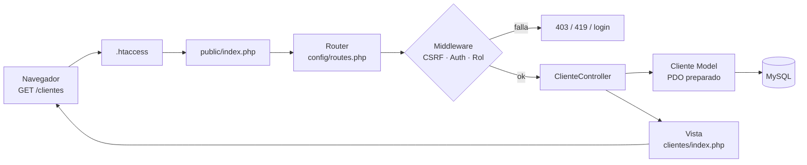
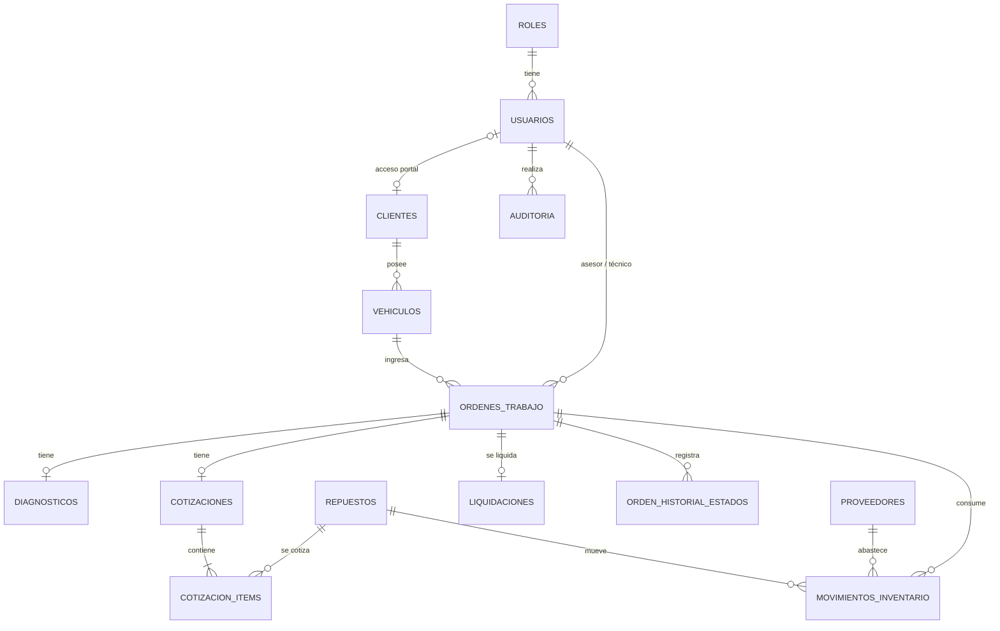
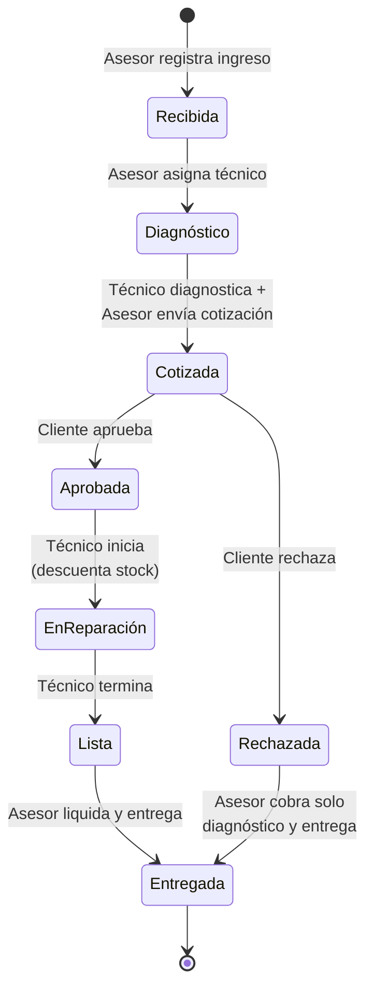

# Torque · Sistema de gestión para taller automotriz

> **Registro del proyecto.** Proyecto final de Desarrollo Web y Móvil, Universidad EAN. Caso 08: Taller automotriz.
> Última actualización: **05/11/2026** (cierre del Sprint 5). Equipo: 2 integrantes.

---

## 1. Información del proyecto

| Aspecto | Detalle |
|---|---|
| **Problema** | El taller controla en papel o en hojas sueltas qué vehículo entró, quién lo revisa, qué se cotizó, qué aprobó el cliente y qué repuestos salieron. Se pierden aprobaciones, el stock no cuadra y el cliente tiene que llamar para saber el estado de su carro. |
| **Objetivo** | Una aplicación web responsive que gestione la orden de trabajo de extremo a extremo (recepción, diagnóstico, cotización, aprobación, reparación, liquidación y entrega), con inventario de repuestos, cuatro roles con permisos reales, auditoría y reportes. |
| **Alcance** | Un taller (una sede), un proceso principal (la orden de trabajo) y procesos de soporte: clientes, vehículos, inventario, proveedores, usuarios y reportes. |
| **Fuera de alcance** | Pasarela de pagos real y facturación electrónica legal (la liquidación es **simulada**). Tampoco incluye notificaciones por correo o SMS, app nativa ni varias sedes. |
| **Datos** | Solo ficticios. |

### Stack (obligatorio según el documento)

| Capa | Tecnología |
|---|---|
| Frontend | HTML5 semántico, CSS3, Bootstrap 5.3 (local), Bootstrap Icons, JavaScript vanilla |
| Backend | PHP 8 orientado a objetos, **MVC propio** (sin frameworks) |
| Base de datos | MySQL / MariaDB (XAMPP 8.0.30 → MariaDB 10.4) vía PDO |
| Entorno | XAMPP + phpMyAdmin |

### Roles

| Rol | Quién es | Qué hace en el sistema |
|---|---|---|
| **Administrador** | Dueño o jefe del taller | Gestiona usuarios, ve todo, consulta la auditoría y los reportes globales. |
| **Asesor** | Atiende al cliente en recepción | Registra clientes, vehículos y órdenes; asigna técnicos; arma cotizaciones; liquida y entrega. |
| **Técnico** | Mecánico | Ve **solo sus órdenes asignadas**, registra el diagnóstico y avanza la reparación. |
| **Cliente** | Dueño del vehículo | Consulta **solo sus vehículos y órdenes**, y aprueba o rechaza cotizaciones. |

---

## 2. Estado actual

| Sprint | Estado | Pruebas |
|---|---|---|
| 0 · Análisis y diseño | ✅ Completo (`ANALISIS_Y_DISENO.md`) | — |
| 1 · Núcleo y seguridad | ✅ Completo | 21 (`tests/pruebas-sprint1.md`) |
| 2A · Usuarios, clientes, vehículos | ✅ Completo | 28 (`tests/pruebas-sprint2.md`) |
| 2B · Proveedores y repuestos | ✅ Completo | 20 (`tests/pruebas-sprint2b.md`) |
| 3A · Orden: recepción → cotización | ✅ Completo | 26 (`tests/pruebas-sprint3a.md`) |
| 3B · Orden: aprobación → entrega | ✅ Completo | 22 (`tests/pruebas-sprint3b.md`) |
| 4 · Reportes | ✅ Completo | 14 (`tests/pruebas-sprint4.md`) |
| 5 · Calidad, documentación y entrega | ✅ Completo | 56 automáticas (`tests/run_tests.php`) |

---

## 3. Arquitectura

### Estructura de carpetas

```
taller/
├── app/
│   ├── Core/          Router, Controller, Model (PDO), View, Session, Csrf, Auth,
│   │                  Validator, FormState, ListParams, ErrorHandler, Logger
│   ├── Middleware/    Auth, Guest, Role, Csrf
│   ├── Controllers/   Auth, Dashboard, Usuario, Cliente, Vehiculo, Auditoria …
│   ├── Models/        Usuario, Cliente, Vehiculo, OrdenTrabajo, Repuesto …
│   ├── Services/      AuthService (y en el Sprint 3: OrdenService)
│   └── Views/         layouts/, partials/, una carpeta por módulo
├── config/            app.php (lee .env), routes.php, menu.php
├── database/          schema.sql, seed.sql, instalar_completo.sql
├── docs/              este documento
├── public/            index.php (front controller) + assets locales
├── storage/logs/      log técnico (no accesible por web)
├── tests/             planes de prueba por sprint
├── .env.example
└── README.md
```

### Recorrido de una petición



---

## 4. Modelo de datos

15 tablas: 8 entidades de negocio, más usuarios y roles, más soporte (intentos, historial, auditoría).



| Tabla | Propósito | Restricciones clave |
|---|---|---|
| `usuarios`, `roles` | Cuentas y permisos | Email único, `activo` |
| `intentos_login` | Bloqueo por fuerza bruta | Índices por email/IP y fecha |
| `clientes` | Dueños de vehículos | (tipo, documento) único, `usuario_id` único |
| `vehiculos` | Vehículos del cliente | Placa única, VIN único, `CHECK` del año |
| `ordenes_trabajo` | **Proceso principal** | Código único, estado `ENUM`, índices por estado y técnico |
| `diagnosticos` | Hallazgos del técnico | 1 por orden |
| `cotizaciones` + `cotizacion_items` | Presupuesto y su respuesta | 1 por orden; precio congelado; `CHECK` del tipo de ítem |
| `repuestos` | Catálogo y stock | `CHECK (stock >= 0)` |
| `proveedores` | Origen de las entradas | NIT único |
| `movimientos_inventario` | Trazabilidad del stock | `CHECK`: entrada→proveedor, salida→orden |
| `liquidaciones` | Cobro **simulado** | 1 por orden |
| `orden_historial_estados` | Línea de tiempo de la orden | Quién, cuándo, de qué estado a cuál |
| `auditoria` | Operaciones críticas (RF-11) | Sin contraseñas ni hashes |

---

## 5. Proceso principal: ciclo de vida de la orden de trabajo



| Transición | Rol | Condición (regla) |
|---|---|---|
| → Recibida | Asesor | Vehículo y cliente activos; **el vehículo no tiene otra orden abierta** |
| Recibida → Diagnóstico | Asesor | Debe elegir un técnico activo |
| Diagnóstico → Cotizada | Técnico + Asesor | El técnico registra el diagnóstico; el asesor arma la cotización con al menos un ítem |
| Cotizada → Aprobada / Rechazada | Cliente | Solo el dueño del vehículo; el rechazo pide un motivo |
| Aprobada → En reparación | Técnico asignado | **Hay stock suficiente**; el descuento se hace en una transacción |
| En reparación → Lista | Técnico asignado | — |
| Lista → Entregada | Asesor | **Existe una liquidación registrada** |
| Rechazada → Entregada | Asesor | Liquidación solo por el valor del diagnóstico |

Cualquier otra transición se rechaza en el servidor. Cada cambio queda en `orden_historial_estados`.

---

## 6. Reglas de negocio (RF-13)

| # | Regla | Estado |
|---|---|---|
| R1 | No se repara sin la aprobación del cliente | ✅ S3B |
| R2 | El stock nunca queda negativo (PHP + `CHECK` en BD + `FOR UPDATE`) | ✅ S3B |
| R3 | El técnico solo ve y modifica sus órdenes asignadas | ✅ S3A |
| R4 | No se entrega un vehículo sin liquidación registrada | ✅ S3B |
| R5 | Un vehículo no puede tener dos órdenes abiertas a la vez | ✅ S3A |
| R6 | Nadie cambia su propio rol ni se desactiva; siempre hay al menos un admin activo | ✅ S2 |
| R7 | No se desactiva un cliente o vehículo con órdenes abiertas | ✅ S2 |
| R8 | Placa colombiana válida y única; VIN según ISO 3779 | ✅ S2 |
| R9 | Los precios se congelan en la cotización (un cambio de precio posterior no la altera) | ✅ S3A |
| R11 | El kilometraje de ingreso no puede ser menor al último registrado | ✅ S3A |
| R10 | Alerta cuando un repuesto llega a su stock mínimo | ✅ S2B |
| R12 | El stock solo cambia mediante movimientos trazables (kardex) | ✅ S2B |

---

## 7. Matriz de permisos (RF-02)

`V` ver · `C` crear · `E` editar · `A` aprobar o cambiar estado · `D` desactivar · `P` solo lo propio

| Módulo | Administrador | Asesor | Técnico | Cliente |
|---|---|---|---|---|
| Tablero | V (global) | V (recepción) | V·P | V·P |
| Usuarios | V C E D | — | — | — |
| Clientes | V C E D | V C E D | — | — |
| Vehículos | V C E D | V C E D | — | V·P |
| Proveedores | V C E D | V | — | — |
| Repuestos / inventario | V C E D + entradas | V + entradas | V (consulta de stock) | — |
| Órdenes de trabajo | V | V C E A | V·P · A·P | V·P |
| Diagnóstico | V | V | C·P | V·P |
| Cotización | V | C E | V·P | V·P · A·P |
| Liquidación / entrega | V | C A | — | V·P |
| Reportes + CSV | V (todos) | V (operativos) | — | — |
| Auditoría | V | — | — | — |

---

## 8. Etapas de desarrollo (sprints)

### Sprint 0 · Análisis y diseño ✅
- [x] Caso, actores, alcance y stack
- [x] Modelo ER y `schema.sql`
- [x] Flujo de estados y reglas de negocio
- [x] Matriz de permisos
- [x] 18 historias de usuario con criterios de aceptación (`ANALISIS_Y_DISENO.md` §7)
- [x] Mapa de navegación y 3 diagramas de flujo de negocio (`ANALISIS_Y_DISENO.md` §6, §10)

### Sprint 1 · Núcleo y seguridad ✅
- [x] MVC propio: Router, Controller, Model (PDO), View
- [x] Login y logout; mensajes genéricos; bloqueo progresivo por intentos (RS-07)
- [x] Contraseñas con `password_hash` y rehash automático a Argon2id (RS-01)
- [x] Sesión segura: HttpOnly, SameSite, regeneración de ID, expiración por inactividad (RS-03)
- [x] Middleware de rol (403 auditado) y CSRF en todo POST (RS-04, RS-05)
- [x] Escape de salida con `e()` (RS-06); `.env` y log fuera de `public/` (RS-08)
- [x] Pantallas 403, 404, 405, 419 y 500
- [x] Tablero distinto por rol con datos reales
- [x] Auditoría con filtro, búsqueda, orden y paginación

### Sprint 2A · Maestros ✅
- [x] CRUD de usuarios con reglas de rol
- [x] CRUD de clientes, con cuenta de portal opcional (transacción)
- [x] CRUD de vehículos con validación de placa y VIN
- [x] Fichas de cliente y de vehículo con su historial
- [x] Listados reutilizables: búsqueda, filtro, orden y paginación (RF-08)
- [x] Validación cliente + servidor con errores por campo (RF-10)
- [x] Accesos directos en los tableros (RF-07)

### Sprint 2B · Proveedores y repuestos ✅
- [x] CRUD de proveedores (NIT único, desactivación lógica)
- [x] CRUD de repuestos: código único, costo, precio de venta ≥ costo y stock mínimo
- [x] Entrada de mercancía: proveedor + cantidad + costo → movimiento + stock (transacción)
- [x] Ajuste de inventario con motivo obligatorio (solo admin, nunca negativo)
- [x] Kardex: movimientos con saldo y verificación de que la suma coincide con el stock
- [x] Filtro "solo en stock mínimo" y alertas en los tableros

### Sprint 3 · Orden de trabajo (proceso principal) ✅
- [x] Recepción: buscar vehículo por placa, motivo, kilometraje y fecha estimada *(3A)*
- [x] Código automático `OT-AAAA-NNNN` *(3A)*
- [x] Asignar y reasignar técnico *(3A)*
- [x] Diagnóstico (técnico, desde el celular) *(3A)*
- [x] Cotización: ítems de mano de obra y repuestos, con totales en vivo *(3A)*
- [x] Aprobación o rechazo por el cliente desde su portal (o registrada por el asesor) *(3B)*
- [x] Iniciar reparación: descuento de stock en una transacción *(3B)*
- [x] Marcar como lista *(3B)*
- [x] Liquidación simulada: subtotales, IVA 19 % y método simulado *(3B)*
- [x] Entrega *(3B)*
- [x] Línea de tiempo de estados en la ficha de la orden *(3A)*
- [x] `OrdenService` con la máquina de estados (transiciones válidas por rol) *(3A)*
- [x] Listado de órdenes con filtros por estado, técnico y fechas *(3A)*

### Sprint 4 · Reportes ✅
- [x] Tableros con 3 o más indicadores calculados (incluye ingresos de 30 días)
- [x] Reporte de órdenes filtrable por fechas, estado y técnico (tiempo promedio en taller, tasa de aprobación)
- [x] Reporte de ingresos simulados por día, semana o mes y por método
- [x] Reporte de repuestos más usados (unidades, vendido y margen)
- [x] Exportación a CSV (RF-09), compatible con Excel y protegida contra inyección de fórmulas
- [x] Gráficas de órdenes por técnico, ingresos por periodo y repuestos (barras de una serie + tabla de datos)

### Sprint 5 · Calidad y entrega ✅
- [x] 56 pruebas automáticas reproducibles (`tests/run_tests.php --reset`) + 131 funcionales (`tests/PLAN_DE_PRUEBAS.md`)
- [x] Autorregistro de clientes desde el login (`/registro`), con protección contra suplantación, enumeración y bots
- [x] Recorrido completo por rol y ataques de prueba de la sección 05 documentados
- [x] Accesibilidad: auditoría con axe-core en 35 pantallas × 2 anchos → **0 violaciones**; navegación con teclado verificada
- [x] Responsive a 360, 390, 768 y 1366 px; capturas en `docs/img/`
- [x] Rendimiento con 20.000 órdenes + optimización de índices (`tests/rendimiento.md`)
- [x] Manual con 6 fallas frecuentes (`docs/MANUAL.md`)
- [x] Bitácora de IA, habilidades y licencias (`docs/BITACORA_IA.md`)
- [x] Guía de diseño (`docs/GUIA_DISENO.md`) y guía de sustentación (`docs/GUIA_SUSTENTACION.md`)
- [ ] **Equipo:** probar en Firefox o Edge (RNF-09)
- [ ] **Equipo:** completar sus aportes propios en `BITACORA_IA.md` §4
- [ ] **Equipo:** repositorio Git con commits significativos (habilidad 8)
- [ ] **Equipo:** ensayo de la sustentación con modificaciones en vivo (`GUIA_SUSTENTACION.md` §6–7)

---

## 9. Producto final: funcionalidades

| Área | Funcionalidad |
|---|---|
| **Acceso** | Login seguro, bloqueo por intentos, expiración de sesión, portal de cliente, autorregistro de clientes |
| **Recepción** | Clientes, vehículos y apertura de órdenes en menos de 1 minuto buscando por placa |
| **Taller** | Bandeja del técnico (móvil), diagnóstico y avance de reparación |
| **Comercial** | Cotización detallada, aprobación del cliente en línea y liquidación simulada |
| **Inventario** | Catálogo, entradas de proveedor, ajustes, kardex, alertas de stock mínimo y descuento automático |
| **Control** | Auditoría, historial por orden, vehículo y cliente, y reportes con CSV |
| **Seguridad** | RS-01 a RS-08 completos y probados |
| **UX** | Responsive, accesible (WCAG 2.2 AA), identidad visual propia y estados vacíos, de error y de carga |

---

## 10. Guía de diseño visual

| Elemento | Decisión | Por qué |
|---|---|---|
| Color base | Grafito `#1c232c` | El tono de un taller: sobrio y de alto contraste |
| Acento | Ámbar de señalización `#f0a71a` | El color de la señalización industrial; marca lo activo y las alertas |
| Placa | Amarillo `#f7c600` con borde negro y fuente monoespaciada | Identidad del dominio: la placa colombiana es la forma natural de identificar un carro |
| Estados | Insignias con texto **y** color, un color por estado | El color nunca va solo (accesibilidad) |
| Tipografía | Sistema (system-ui) | Rápida, legible y sin dependencias externas |
| Tablas en móvil | Se convierten en tarjetas con etiqueta | Evita el scroll horizontal (RNF-03) |
| Iconos | Bootstrap Icons, siempre con `aria-hidden` y texto | Accesibilidad |

---

## 11. Mockups del producto final

> Wireframes de baja fidelidad. ✅ = pantalla ya construida · ⏳ = propuesta.
> Convenciones: `[Botón]`, `( ) radio`, `[x] checkbox`, `▾ select`, `▌ABC123▐` placa, `●` estado.

### 11.1 Login ✅

```
┌───────────────────────────────────────────────────────────────────┐
│ ┌───────────────────────┐┃┌──────────────────────────────────────┐ │
│ │ [🔧]                   │┃│ Iniciar sesión                        │ │
│ │ TORQUE                 │┃│ Ingresa con la cuenta que te asignó   │ │
│ │ Gestión de órdenes     │┃│                                       │ │
│ │                        │┃│ Correo electrónico                    │ │
│ │ ① Recepción            │┃│ [______________________________]      │ │
│ │ ② Diagnóstico          │┃│ Contraseña                            │ │
│ │ ③ Cotización           │┃│ [__________________________] [👁]     │ │
│ │ ④ Reparación           │┃│                                       │ │
│ │ ⑤ Entrega              │┃│ [            Ingresar            ]    │ │
│ └───────────────────────┘┃└──────────────────────────────────────┘ │
└───────────────────────────────────────────────────────────────────┘
```

### 11.2 Tablero del asesor ✅ (los indicadores y accesos se amplían en S3)

```
┌──────────────────────────────────────────────────────────────────────┐
│ ☰ [🔧] TORQUE                          Andrés Rojas [Asesor]  [Salir]│
├────────────┬─────────────────────────────────────────────────────────┤
│ ▸ Inicio   │ Recepción y seguimiento      [+ Nueva orden] [+ Cliente]│
│   Órdenes  │                                                         │
│   Clientes │ ┌─────────────┐┌─────────────┐┌─────────────┐┌────────┐ │
│   Vehículos│ │Sin técnico  ││Esperando    ││Listas para  ││Stock   │ │
│   Inventar.│ │     2       ││cliente   1  ││entrega   0  ││mín.  2 │ │
│   Reportes │ └─────────────┘└─────────────┘└─────────────┘└────────┘ │
│            │ ┌ Órdenes recientes ──────────────────┐┌ Stock mínimo ┐ │
│            │ │OT-0004 ▌HTS219▐ Logan  ● Recibida   ││Filtro Spark  │ │
│            │ │OT-0003 ▌TRK905▐ Hino   ● Recibida   ││   3 / mín 5  │ │
│            │ │OT-0002 ▌KLM482▐ Spark  ● Diagnóstico││Correa dist.  │ │
│            │ │OT-0001 ▌BQX731▐ Mazda3 ● Cotizada   ││   2 / mín 2  │ │
│            │ └─────────────────────────────────────┘└──────────────┘ │
└────────────┴─────────────────────────────────────────────────────────┘
```

### 11.3 Nueva orden de trabajo (recepción) ⏳

```
┌ Órdenes / Nueva ───────────────────────────────────────────────────┐
│ Nueva orden de trabajo                                             │
│                                                                    │
│ Placa del vehículo                                                 │
│ [ KLM482        ] [🔍 Buscar]                                      │
│ ┌──────────────────────────────────────────────────────────────┐   │
│ │ ▌KLM482▐ Chevrolet Spark GT 2017 · Rojo                       │   │
│ │ Propietario: María Fernanda Gómez · 3001234567                │   │
│ │ ⚠ Este vehículo ya tiene la orden OT-2026-0002 abierta (R5)   │   │
│ └──────────────────────────────────────────────────────────────┘   │
│  ¿No existe? [+ Registrar vehículo]                                │
│                                                                    │
│ Motivo de ingreso *                                                │
│ [ Testigo de motor encendido y pérdida de potencia…           ]    │
│ Kilometraje *          Fecha estimada de entrega                   │
│ [ 91250     ] km       [ 08/11/2026 📅 ]                           │
│ Técnico (opcional)                                                 │
│ [ Sin asignar todavía                                     ▾ ]      │
│                                                                    │
│                               [Cancelar] [Registrar ingreso]       │
└────────────────────────────────────────────────────────────────────┘
```

### 11.4 Listado de órdenes ⏳

```
┌ Órdenes de trabajo ────────────────────────────── [+ Nueva orden] ┐
│ [Buscar placa, código o cliente____] Estado▾ Técnico▾ Desde[ ] Hasta[ ] [Filtrar]│
│ ● Todas 18 │ Recibida 2 │ Diagnóstico 1 │ Cotizada 1 │ En reparación 3 │ Lista 0 │
├───────────┬───────────────────┬────────────┬───────────┬──────────────┬──────────┤
│ ORDEN ⇅   │ VEHÍCULO          │ CLIENTE    │ TÉCNICO   │ ESTADO       │ INGRESO ⇅│
├───────────┼───────────────────┼────────────┼───────────┼──────────────┼──────────┤
│OT-2026-0004│▌HTS219▐ Logan    │ M. Gómez   │ Sin asignar│● Recibida    │ 05/11    │
│OT-2026-0001│▌BQX731▐ Mazda 3  │ Ó. Beltrán │ C. Pardo  │● Cotizada    │ 02/11    │
├───────────┴───────────────────┴────────────┴───────────┴──────────────┴──────────┤
│ « 1 2 »                                                                          │
└──────────────────────────────────────────────────────────────────────────────────┘
```

### 11.5 Ficha de la orden (vista del asesor) ⏳: la pantalla central del sistema

```
┌ Órdenes / OT-2026-0001 ────────────────────────────────────────────┐
│ OT-2026-0001  ▌BQX731▐ Mazda 3 Touring        ● Cotizada            │
│ ①Recibida ━ ②Diagnóstico ━ ③Cotizada ─ ④Aprobada ─ ⑤Reparación ─ ⑥Lista ─ ⑦Entregada │
├──────────────────────────────┬──────────────────────────────────────┤
│ Ingreso                      │ Cotización · Esperando al cliente     │
│ Cliente: Óscar Beltrán       │ ┌──────────────────────┬───┬────────┐ │
│ Tel: 3109876543              │ │Pastillas delanteras  │ 1 │ 98.000 │ │
│ Km: 58.400                   │ │Líquido DOT 4         │ 1 │ 27.000 │ │
│ Motivo: Ruido metálico al    │ │Mano de obra: cambio  │ 1 │ 85.000 │ │
│ frenar…                      │ ├──────────────────────┴───┼────────┤ │
│ Técnico: Camilo Pardo        │ │Subtotal                  │210.000 │ │
│ Entrega estimada: 07/11      │ │IVA 19 %                  │ 39.900 │ │
│                              │ │TOTAL                     │249.900 │ │
│ Diagnóstico (C. Pardo)       │ └──────────────────────────┴────────┘ │
│ Pastillas al 10 %. Discos    │ ⓘ Enviada el 03/11 10:20.             │
│ dentro de tolerancia…        │   El cliente la ve en su portal.      │
├──────────────────────────────┴──────────────────────────────────────┤
│ Historial                                                           │
│ 03/11 10:20  Andrés Rojas   Diagnóstico → Cotizada                  │
│ 02/11 15:05  Andrés Rojas   Recibida → Diagnóstico (Camilo Pardo)   │
│ 02/11 14:02  Andrés Rojas   Ingreso del vehículo                    │
└─────────────────────────────────────────────────────────────────────┘
  Las acciones cambian según estado y rol. Ej. en "Lista": [Liquidar y entregar]
```

### 11.6 Bandeja y diagnóstico del técnico, en el celular ⏳

```
┌──────────────────────┐   ┌──────────────────────┐
│☰ [🔧]  Camilo [Téc.]│   │← OT-2026-0002        │
├──────────────────────┤   │▌KLM482▐ Spark GT     │
│ Mis órdenes (2)      │   │● Diagnóstico         │
│┌────────────────────┐│   ├──────────────────────┤
││OT-0002   ●Diagnóst.││   │Motivo del cliente:   │
││▌KLM482▐ Spark GT   ││   │Testigo de motor y    │
││Ingresó hace 1 día  ││   │pérdida de potencia.  │
││ [Registrar diagnós.]││   │Km: 91.250            │
│└────────────────────┘│   │                      │
│┌────────────────────┐│   │Diagnóstico *         │
││OT-0001  ●Cotizada  ││   │┌────────────────────┐│
││▌BQX731▐ Mazda 3    ││   ││Bobina del cil. 3   ││
││Esperando cliente   ││   ││defectuosa; bujías  ││
│└────────────────────┘│   ││desgastadas…        ││
│                      │   │└────────────────────┘│
│                      │   │[  Guardar diagnóstico ]│
└──────────────────────┘   └──────────────────────┘
 Solo ve sus órdenes (R3)    Luego, en "Aprobada": [Iniciar reparación]
```

### 11.7 Portal del cliente: aprobar la cotización (celular) ⏳

```
┌──────────────────────┐   ┌──────────────────────┐
│☰ [🔧] Óscar [Cliente]│   │ Rechazar cotización  │
├──────────────────────┤   ├──────────────────────┤
│⚠ 1 cotización espera │   │ ¿Por qué la rechazas?│
│  tu respuesta        │   │ ( ) Muy costosa      │
│┌────────────────────┐│   │ ( ) Lo haré en otro  │
││▌BQX731▐ Mazda 3    ││   │     lugar            │
││OT-2026-0001        ││   │ ( ) Otro:            │
││Diagnóstico:        ││   │ [_________________]  │
││Pastillas al 10 %…  ││   │                      │
││────────────────────││   │ Se cobrará solo el   │
││Pastillas    98.000 ││   │ diagnóstico y podrás │
││Líquido      27.000 ││   │ recoger tu vehículo. │
││Mano de obra 85.000 ││   │                      │
││IVA          39.900 ││   │[Cancelar] [Rechazar] │
││TOTAL       249.900 ││   └──────────────────────┘
││                    ││
││[ ✓ Aprobar ]       ││
││[ ✗ Rechazar ]      ││
│└────────────────────┘│
└──────────────────────┘
 Solo ve lo suyo (RS-04); confirmación antes de decidir
```

### 11.8 Liquidación simulada y entrega ⏳

```
┌ OT-2026-0001 / Liquidar ───────────────────────────────────────────┐
│ ⓘ SIMULACIÓN: no se procesa ningún pago real                       │
│                                                                    │
│ Mano de obra ............................................ 85.000   │
│ Repuestos ............................................... 125.000  │
│ IVA 19 % ................................................ 39.900   │
│ ───────────────────────────────────────────────────────────────    │
│ TOTAL ................................................... 249.900  │
│                                                                    │
│ Método (simulado)   ( ) Efectivo  (•) Tarjeta  ( ) Transferencia   │
│ [x] Confirmo que el cliente recibe el vehículo                     │
│                                                                    │
│                         [Cancelar] [Registrar liquidación y entregar]│
└────────────────────────────────────────────────────────────────────┘
 Sin liquidación no se puede entregar (R4)
```

### 11.9 Inventario de repuestos y entrada de mercancía ⏳ (Sprint 2B)

```
┌ Repuestos ──────────────────────── [+ Entrada de mercancía] [+ Repuesto]┐
│ [Buscar código o nombre______]  [x] Solo en stock mínimo   [Filtrar]   │
├──────────────┬──────────────────────────┬────────┬────────┬────────────┤
│ CÓDIGO ⇅     │ REPUESTO ⇅               │ PRECIO │ STOCK ⇅│            │
├──────────────┼──────────────────────────┼────────┼────────┼────────────┤
│ FIL-ACE-SPK  │ Filtro de aceite Spark   │ 22.000 │ ⚠ 3/5  │[Kardex][✎] │
│ COR-DIST     │ Correa de distribución   │175.000 │ ⚠ 2/2  │[Kardex][✎] │
│ FRN-PAST-DEL │ Pastillas delanteras     │ 98.000 │  12/4  │[Kardex][✎] │
└──────────────┴──────────────────────────┴────────┴────────┴────────────┘

┌ Entrada de mercancía (modal) ──────────────┐   ┌ Kardex · FIL-ACE-SPK ─────────────────────┐
│ Proveedor *   [ Autopartes La 13     ▾ ]   │   │ FECHA  TIPO     CANT  SALDO  REFERENCIA    │
│ Repuesto *    [ FIL-ACE-SPK · Filtro ▾ ]   │   │ 05/11  Entrada  +10   13    Autopartes 13  │
│ Cantidad *    [ 10 ]                       │   │ 03/11  Salida    -1    3    OT-2026-0002   │
│ Costo unit.   [ 14.000 ]                   │   │ 01/11  Ajuste    -1    4    Conteo físico  │
│ Nota          [ Factura prov. 4521 ]       │   └───────────────────────────────────────────┘
│              [Cancelar] [Registrar entrada]│
└────────────────────────────────────────────┘
```

### 11.10 Reportes ⏳ (Sprint 4)

```
┌ Reportes ──────────────────────────────────────────────────────────┐
│ Reporte▾ [Órdenes por periodo]  Desde[01/10/2026] Hasta[31/10/2026]│
│ Estado▾ [Todos]  Técnico▾ [Todos]         [Aplicar] [⬇ Exportar CSV]│
├────────────────────────────────────────────────────────────────────┤
│ ┌─────────────┐┌─────────────┐┌─────────────┐┌─────────────┐       │
│ │Órdenes      ││Tiempo prom. ││Tasa de      ││Ingresos     │       │
│ │cerradas  42 ││reparación   ││aprobación   ││(simulados)  │       │
│ │             ││   2,3 días  ││    81 %     ││ $8.240.000  │       │
│ └─────────────┘└─────────────┘└─────────────┘└─────────────┘       │
│ Órdenes por técnico                                                │
│ Camilo Pardo   ████████████████████ 24                             │
│ Julián Vargas  ███████████████ 18                                  │
│ ┌──────────┬──────────┬──────────┬──────────┬──────────┐           │
│ │ ORDEN    │ PLACA    │ TÉCNICO  │ ESTADO   │ TOTAL    │  « 1 2 3 »│
│ └──────────┴──────────┴──────────┴──────────┴──────────┘           │
└────────────────────────────────────────────────────────────────────┘
 Todos los indicadores salen de consultas reales a MySQL (no son inventados)
```

---

## 12. Entregables (sección 08 del documento)

| # | Entregable | Estado |
|---|---|---|
| 1 | Código fuente MVC + `.env.example` | ✅ |
| 2 | `schema.sql` + `seed.sql` con cuentas por rol | ✅ `instalar_completo.sql` |
| 3 | Análisis: empresa, problema, objetivos, mapa de navegación, actores, 12 o más historias, matriz de permisos | ✅ `ANALISIS_Y_DISENO.md` |
| 4 | Diseño técnico: ER, MVC, rutas y 2 o más diagramas de flujo | ✅ `ANALISIS_Y_DISENO.md` |
| 5 | Guía de diseño visual + evidencias responsive | ✅ `GUIA_DISENO.md` + `img/` |
| 6 | Matriz RF/RNF + 20 o más pruebas con evidencia | ✅ `MATRIZ_REQUISITOS.md` + `tests/PLAN_DE_PRUEBAS.md` |
| 7 | Bitácora de IA + skills + decisiones propias | 🟡 `BITACORA_IA.md` (el equipo completa §4) |
| 8 | Manual: instalación, roles, uso y 3 fallas frecuentes | ✅ `MANUAL.md` |
| 9 | Sustentación en vivo | 🟡 Preparada en `GUIA_SUSTENTACION.md` |

---

## Anexo A · Historias de usuario (borrador)

| ID | Como… | Quiero… | Para… |
|---|---|---|---|
| HU-01 | usuario | iniciar sesión de forma segura | acceder solo a lo que me corresponde |
| HU-02 | administrador | crear, editar y desactivar usuarios | controlar quién usa el sistema |
| HU-03 | asesor | registrar clientes y sus vehículos | tener sus datos al recibirlos |
| HU-04 | asesor | abrir una orden buscando por placa | registrar el ingreso rápido |
| HU-05 | asesor | asignar un técnico a la orden | que empiece el diagnóstico |
| HU-06 | técnico | ver solo mis órdenes desde el celular | saber qué me toca |
| HU-07 | técnico | registrar el diagnóstico | que el asesor pueda cotizar |
| HU-08 | asesor | armar una cotización con repuestos y mano de obra | informar el costo al cliente |
| HU-09 | cliente | aprobar o rechazar la cotización en línea | decidir sin ir al taller |
| HU-10 | técnico | iniciar y terminar la reparación | que el stock y el estado se actualicen |
| HU-11 | asesor | liquidar y entregar el vehículo | cerrar la orden |
| HU-12 | asesor | registrar entradas de repuestos de un proveedor | mantener el stock real |
| HU-13 | asesor | ver alertas de stock mínimo | pedir a tiempo |
| HU-14 | cliente | ver el estado y el historial de mis vehículos | no tener que llamar |
| HU-15 | administrador | filtrar reportes y exportarlos a CSV | analizar la operación |
| HU-16 | administrador | consultar la auditoría | saber quién hizo qué |

## Anexo B · Decisiones técnicas para la bitácora de IA

| Fecha | Decisión / corrección | Origen |
|---|---|---|
| 04/11 | Liquidación **simulada** en vez de facturación real | Equipo, según el documento (pagos simulados) |
| 04/11 | Inventario nivel (b): entradas de proveedor + stock mínimo | Equipo |
| 04/11 | Corrección del charset: `SET NAMES utf8mb4` (las tildes salían dañadas al importar) | Detectado en pruebas |
| 04/11 | Corrección del menú lateral transparente en escritorio | Detectado en pruebas visuales |
| 05/11 | Rol y estado del usuario releídos de la BD en cada petición (un usuario desactivado pierde el acceso al instante) | Diseño |
| 05/11 | Excluir `acceso_password` de la auditoría (se iba a guardar) | Detectado en revisión |
| 05/11 | Desactivar un cliente también desactiva sus vehículos (transacción) | Regla de negocio añadida |
| 05/11 | Corrección del JS: el correo quedaba obligatorio al desmarcar el acceso | Detectado en pruebas con navegador |
| 05/11 | El precio de los repuestos se toma del catálogo en el servidor (se ignora el del navegador) | Diseño de seguridad; probado con un precio manipulado |
| 05/11 | Corrección del editor de cotización: `[data-precio]` coincidía con las `<option>` y el total se calculaba mal | Detectado en pruebas con navegador |
| 05/11 | Bloqueo optimista en el cambio de estado (`WHERE estado = :actual`) y `FOR UPDATE` en el consecutivo y el vehículo | Diseño (concurrencia) |
| 05/11 | Regla R11: el kilometraje no retrocede | Regla añadida |
| 05/11 | La prueba de concurrencia del stock se repitió con varios procesos (`PHP_CLI_SERVER_WORKERS=4`), porque el servidor de PHP por defecto atiende una petición a la vez y la primera prueba no era concurrencia real | Corrección del método de prueba |
| 05/11 | Bloqueo de repuestos en orden ascendente de id para evitar bloqueos cruzados (deadlocks) | Diseño |
| 05/11 | Liquidación y entrega en un solo paso transaccional (hace imposible violar R4) | Diseño |
| 05/11 | En celular, la tabla de cotización oculta "Valor unit." y lo muestra bajo el concepto (antes se cortaba) | Detectado en pruebas visuales |
| 05/11 | El stock no se edita en el formulario del repuesto; solo con movimientos (trazabilidad total) | Diseño |
| 05/11 | Corrección: `min="1" step="100"` hacía que el navegador rechazara precios como $66.000 (solo aceptaba 1, 101, 201…); se cambió a `step="1"` | Detectado en pruebas con navegador |
| 05/11 | Seed con movimientos iniciales para que el kardex cuadre con el stock desde la instalación | Diseño de datos |
| 05/11 | Histórico de 36 órdenes generado con un script reproducible y validado con 6 consultas de integridad | Diseño de datos |
| 05/11 | Corrección: el histórico tenía entregas a las 02:44 y a las 23:50; se generó de nuevo en horario laboral | Detectado al revisar el reporte |
| 05/11 | Corrección: el promedio por técnico incluía las órdenes rechazadas y el indicador general no | Detectado al comparar las cifras |
| 05/11 | CSV con `;`, BOM y protección contra inyección de fórmulas (`=`, `+`, `-`, `@`) | Diseño de seguridad |

## Anexo C · Decisiones confirmadas (05/11/2026)

1. ✅ **Descuento de stock:** al iniciar la reparación, en una transacción.
2. ✅ **Cotización rechazada:** se cobra solo el diagnóstico (`TARIFA_DIAGNOSTICO` en `.env`) y se entrega, sin re-cotizar.
3. ✅ **Aprobación presencial o telefónica:** el asesor puede registrar la respuesta de un cliente; queda constancia del canal y de quién la registró (`cotizaciones.canal_respuesta`).
4. ✅ **IVA:** 19 % (`TALLER_IVA`), solo como cálculo simulado.
